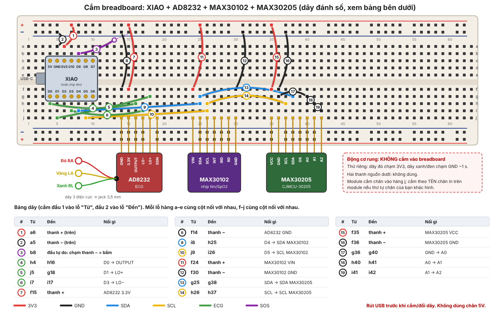
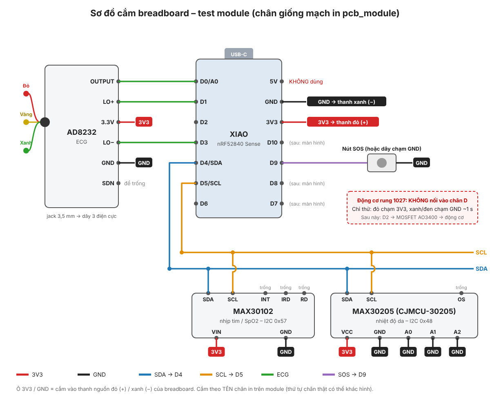

# Test các module đã có trên breadboard

Cắm XIAO và các module đã mua lên breadboard, nạp `test_breadboard.ino`, rồi xem trên Serial Monitor từng module có chạy không.
Số chân giữ đúng như mạch in `hardware/pcb_module`, nên code test xong dùng lại được khi có mạch in.





## 1. Chuẩn bị

| Cần có | Ghi chú |
|---|---|
| XIAO nRF52840 Sense đã hàn chân header đực | Hàn chân hướng xuống (mặt có chip quay lên). Mạch in sau này cũng cắm XIAO lên header cái, nên hàn chân bây giờ không phí. |
| MAX30102, CJMCU-30205 (MAX30205), AD8232 đã hàn chân header | Các module thường bán kèm thanh chân rời, cần hàn trước khi cắm breadboard. |
| Dây cắm đực-đực, khoảng 15 sợi | Nằm trong danh sách cần mua. Không có dây thì chưa test được. |
| Bộ dây điện cực 3 cực + miếng dán | Đã có. |
| Động cơ rung 1027 | Chỉ thử quay bằng chân 3V3, xem mục 2.5. |

Toàn bộ module chạy **3,3 V**. Không nối module nào vào chân **5V** của XIAO, nhất là MAX30205 (tối đa 3,6 V).

## 2. Cắm dây

Chân XIAO khi nhìn từ trên xuống, cổng USB-C ở phía trên:

```
            [ USB-C ]
   D0/A0  o           o  5V      <- KHÔNG dùng
   D1     o           o  GND
   D2     o           o  3V3
   D3     o           o  D10
   D4/SDA o           o  D9
   D5/SCL o           o  D8
   D6     o           o  D7
```

Cắm XIAO **vắt ngang rãnh giữa** breadboard để hai hàng chân không bị chập. Rồi nối:

- **3V3** của XIAO → thanh nguồn đỏ (+) của breadboard.
- **GND** của XIAO → thanh nguồn xanh (−).

Từ đây mọi chân VCC/VIN/3.3V của module lấy từ thanh đỏ, mọi chân GND lấy từ thanh xanh.
Nếu breadboard dài, thanh nguồn có thể bị đứt ở giữa (vạch đỏ/xanh bị ngắt quãng). Khi đó cắm module cùng nửa với XIAO, hoặc nối cầu hai nửa.

Nên cắm và test **từng module một** theo thứ tự dưới đây, xong cái này mới cắm thêm cái kia. Có lỗi thì biết ngay là module nào.

### 2.1 MAX30205 (CJMCU-30205), đo nhiệt độ da

| Chân module | Nối vào |
|---|---|
| VCC | 3V3 (thanh đỏ) |
| GND | GND (thanh xanh) |
| SDA | D4 |
| SCL | D5 |
| A0, A1, A2 (nếu module có ra chân) | GND |
| OS | để trống |

### 2.2 MAX30102, nhịp tim và SpO2

| Chân module | Nối vào |
|---|---|
| VIN | 3V3 |
| GND | GND |
| SDA | D4 (chung hàng với SDA của MAX30205) |
| SCL | D5 (chung hàng với SCL của MAX30205) |
| INT, IRD, RD | để trống |

Trước khi cắm, lật module MAX30102 lên xem jumper điện trở kéo lên I2C (3 miếng đồng cạnh nhau, ghi 1.8V và 3.3V).
Nếu đang hàn sang **1.8V** thì chuyển sang **3.3V**. Để 1.8V thì XIAO đọc không ổn định, nhất là khi cắm chung với MAX30205.

### 2.3 AD8232, điện tim ECG

| Chân module | Nối vào |
|---|---|
| 3.3V | 3V3 |
| GND | GND |
| OUTPUT | D0 (A0) |
| LO+ | D1 |
| LO− | D3 |
| SDN | để trống |

Trên breadboard tạm dùng D3 cho LO−. Trên mạch in, LO+ và LO− được gộp vào D1 qua 2 diode, còn D3 dành cho đèn nền màn hình.

Cắm dây điện cực vào jack 3,5 mm của module. Dán điện cực (thử nhanh):
- **Đỏ (RA)**: dưới xương đòn phải, hoặc cổ tay phải.
- **Vàng (LA)**: dưới xương đòn trái, hoặc cổ tay trái.
- **Xanh (RL)**: bụng dưới bên phải, hoặc mắt cá chân phải.

Nếu đầu dây có in chữ R/L/F thì làm theo chữ in. Chỉ đo khi laptop **đã rút sạc**: cắm điện lưới thì nhiễu 50 Hz rất lớn, và an toàn hơn.

### 2.4 Nút SOS

Chưa có nút 6x6 thì dùng một dây đực-đực cắm vào **D9**, đầu kia chạm vào thanh GND để giả lập bấm nút.
Khi có nút: một chân nút vào D9, chân chéo đối diện vào GND. Không cần điện trở, code đã bật điện trở kéo lên bên trong.

### 2.5 Động cơ rung 1027

**Không nối động cơ vào chân D nào.** Động cơ ăn khoảng 60-90 mA, chân D của XIAO chỉ chịu vài mA và có thể hỏng.
Bây giờ chỉ thử động cơ còn sống: chạm dây đỏ vào 3V3, dây xanh/đen vào GND khoảng 1 giây, thấy rung là được.
Điều khiển bằng D2 phải có MOSFET AO3400 và diode SS14 (đã có trong danh sách cần mua), cắm giống mạch in.

## 3. Cài phần mềm và nạp code

Máy SV1 đã cài đủ từ ngày 05/10 (xem `firmware/README.md`), nên thường chỉ cần làm bước 3.3.

1. **Gói board:** Arduino IDE → File → Preferences → Additional boards manager URLs, thêm
   `https://files.seeedstudio.com/arduino/package_seeeduino_boards_index.json`.
   Tools → Board → Boards Manager, tìm **Seeed nRF52 Boards**, cài bản 1.1.13. Không chọn gói *mbed-enabled*.
2. **Thư viện:** Sketch → Include Library → Manage Libraries, tìm và cài:
   - `SparkFun MAX3010x Pulse and Proximity Sensor Library` (MAX30102)
   - `Seeed Arduino LSM6DS3` (cảm biến chuyển động trên XIAO)

   MAX30205 và AD8232 không cần thư viện: code đọc thẳng thanh ghi và chân analog.
3. **Nạp code:**
   1. Mở Command Prompt, chạy `cd C:\DoAnTotNghiep` rồi `git pull` để lấy thư mục mới.
   2. Mở `C:\DoAnTotNghiep\firmware\test_breadboard\test_breadboard.ino` bằng Arduino IDE.
   3. Tools → Board → Seeed nRF52 Boards → **Seeed XIAO nRF52840 Sense**. Tools → Port → cổng COM của XIAO.
   4. Bấm Upload (mũi tên →). Không thấy cổng COM thì bấm nhanh 2 lần nút RESET trên XIAO rồi chọn lại cổng.
   5. Mở Tools → Serial Monitor, chọn **115200 baud**.

## 4. Kết quả mong đợi

Khi mới chạy, sketch quét I2C và báo từng module:

```
# ===== Test breadboard =====
# Quet I2C (D4/D5), tim thay: 0x48 0x57
# MAX30102 (0x57): OK
# MAX30205: OK o dia chi 0x48
# IMU: OK
```

Sau đó mỗi nửa giây in một dòng:

```
IR=112345 (co ngon tay) | T=33.12 C | Z=1.00 g | ECG=2050 | dien cuc: OK | SOS: nha
```

| Thử | Kết quả đúng |
|---|---|
| Đặt ngón tay lên MAX30102 | IR tăng từ vài nghìn lên trên 50000 |
| Kẹp MAX30205 giữa 2 ngón tay | T tăng dần lên khoảng 32-35 °C |
| Nghiêng hoặc lật XIAO | Z đổi từ khoảng 1,00 về 0 hoặc −1,00 |
| Bóc một miếng điện cực | `dien cuc: TUOT` |
| Dán đủ 3 điện cực, ngồi yên | ECG dao động quanh 1500-2500 |
| Chạm dây D9 vào GND | `SOS: BAM` |

Muốn xem dạng sóng: nạp `firmware/doc_max30102` hoặc `firmware/doc_ad8232`, đóng Serial Monitor, mở Tools → Serial Plotter.
Trong Serial Plotter, bấm vào chữ `t_ms` ở chú thích để ẩn đường thời gian thì mới thấy rõ sóng.

## 5. Lỗi thường gặp

| Hiện tượng | Cách xử lý |
|---|---|
| Quét I2C không thấy gì | Kiểm tra dây SDA → D4, SCL → D5 có bị cắm lệch một lỗ không; module có dây 3V3 và GND chưa. |
| Có 0x48 nhưng không có 0x57 | MAX30102 đang để jumper kéo lên 1,8 V, chuyển sang 3,3 V (mục 2.2). Hoặc rút MAX30205 ra, thử MAX30102 một mình. |
| MAX30205 ở địa chỉ 0x49-0x4F | Chân A0/A1/A2 chưa nối GND. Code vẫn đọc được, nhưng mạch in dùng 0x48. |
| `IMU: LOI` | Không liên quan dây cắm (IMU nằm sẵn trên XIAO). Rút USB cắm lại, nạp lại. |
| ECG luôn ở 0 hoặc 4095, `dien cuc: TUOT` | Miếng dán khô hoặc dán lệch, hoặc jack 3,5 mm chưa cắm hết. |
| ECG có nhưng sóng nhiễu dày đặc | Laptop đang cắm sạc. Rút sạc, ngồi yên, để dây điện cực xa dây nguồn. |
| `SOS: BAM` liên tục | Dây D9 đang chạm GND hoặc nút cắm sai chiều. Nút 4 chân: dùng 2 chân chéo nhau. |
| Upload báo lỗi cổng COM | Bấm nhanh 2 lần nút RESET trên XIAO, chọn lại cổng COM mới (đã gặp COM3 → COM5). |
