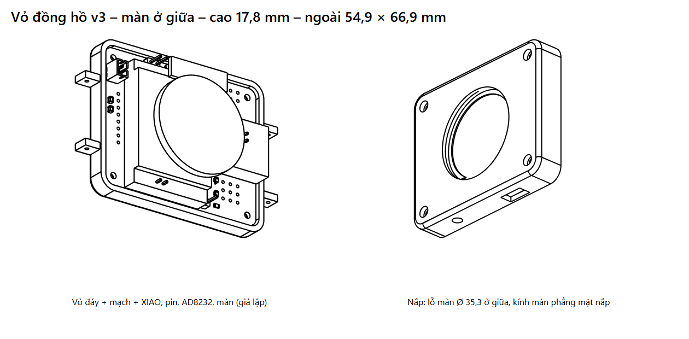

# Vỏ đồng hồ – bản v3 (mỏng, in thử)

Vỏ 2 phần cho mạch module 1.3 (50,1 × 62,1 mm), vẽ bằng CadQuery (Python) từ file STEP của mạch.
Mở được trong Onshape: Import file `.step` (vẽ tiếp, sửa kích thước); in 3D bằng file `.stl`.

**Dùng bản `v3/`**: cao **17,8 mm** (v2: 26,1 mm), ngoài 54,9 × 66,9 mm như cũ.
v3 **chỉ lắp vừa khi đã làm bước 1**: XIAO hàn thẳng xuống mạch (không header cái), AD8232 đã tháo jack 3,5 mm
và hàng 6 chân, hàn dây 30 AWG. Nếu chưa làm bước 1 thì in `v2/` (theo số đo thật 01/11/2026). `v1/` để tham khảo.



| File | Nội dung |
|---|---|
| `v3/vo_day.step`, `v3/vo_day.stl` | Vỏ đáy (mặt da): chứa mạch, cửa sổ cảm biến, hốc điện cực, tai đeo dây |
| `v3/vo_nap.step`, `v3/vo_nap.stl` | Nắp: lỗ màn Ø 35,3 vừa khít (kính màn phẳng mặt nắp), gờ đỡ màn, lỗ cạnh |
| `v3/lap_rap_vo_mach.step` | Lắp ráp: vỏ + mạch 1.3 + khối giả lập XIAO, pin, AD8232, màn |
| `cong_cu/vo_dong_ho.py` | Script tạo vỏ; sửa thông số ở đầu file rồi chạy lại |

Đã kiểm tra bằng máy: vỏ đáy, nắp và nút SOS không chạm mạch 1.3 (kể cả header J5), không chạm khối XIAO, pin,
AD8232, màn.

## Bước 2: v3 bớt chiều cao so với v2 (không tốn tiền)

| Thay đổi | Bớt |
|---|---|
| XIAO hàn thẳng (bước 1A): 16,5 → ~7 mm | không còn quyết định chiều cao |
| AD8232 bỏ jack (bước 1B): 8 → ~2,5 mm | −5,5 mm |
| Lỗ nắp vừa khít Ø 35,3, kính màn ngang mặt nắp, không có nhựa đè lên (giống đồng hồ thật) | −1,5 mm |
| Cột đỡ mạch 3,5 → 3,0 mm (MAX30102 cao 3 mm, vừa đủ) | −0,5 mm |
| Đáy vỏ 1,5 → 1,2 mm | −0,3 mm |
| Mút dưới pin 1 → 0,5 mm (hoặc chỉ dán Kapton) | −0,5 mm |

## Kích thước và xếp chồng (v3)

- Ngoài: **54,9 × 66,9 mm**, cao **17,8 mm** (chưa tính tai dây). Thành 2 mm, khe hở quanh mạch 0,4 mm.
- Màn vẫn đặt lệch xuống, nằm trên vùng pin (tâm màn cách mép dưới mạch 20,6 mm, giữa theo chiều ngang).

| Lớp (tính từ mặt da) | Cao (mm) |
|---|---|
| Đáy vỏ | 0 – 1,2 |
| Linh kiện mặt dưới mạch (MAX30102 3 mm, CJMCU-30205, D1/Q1) | 1,2 – 4,2 (4 cột đỡ 3,0 mm) |
| Mạch 1.3 | 4,2 – 5,8 |
| Mặt ghép đáy / nắp | 6,8 |
| Mút 0,5 + pin 5,5 | 5,8 – 11,8 |
| AD8232 (đã bỏ jack) | 11,8 – 14,3 |
| XIAO hàn thẳng | 5,8 – 12,8 |
| Gờ đỡ màn | 14,3 – 14,8 |
| Module màn (mặt kính = mặt nắp) | 14,8 – 17,8 |

## Các chi tiết

- **4 vít M2 × 14 mm** (tự ren) xuyên nắp → lỗ mạch H1–H4 → cột vỏ đáy (lỗ mồi 1,7 mm). Đầu vít chìm trong lỗ
  khoét Ø 4,2 × 2 mm ở mặt nắp.
- **Màn**: lỗ Ø 35,3 mm xuyên nắp, màn ấn từ trong ra, kính phẳng mặt nắp. Bên dưới có gờ vòng 0,5 mm rộng 1,5 mm
  đỡ mép màn; chấm keo UV/B-7000 quanh mép. Vành và gờ chừa chỗ cho tai chân 7 chân quay về bên trái; mặt dưới nắp
  ở vùng tai được khoét bớt (nắp còn 1,2 mm) để tai chân không cấn.
- **Cửa sổ MAX30102**: lỗ 13 × 9 mm, bậc 15 × 11 mm sâu 0,7 mm phía trong để dán **mica trong 0,5–0,7 mm**
  (vành giữ mica còn 0,5 mm). Không có mica mỏng thì dán miếng nhựa trong mỏng hoặc để trống.
- **Cửa sổ MAX30205**: lỗ 8 × 8 mm cho cảm biến nhiệt áp sát da.
- **Điện cực LA, RL**: mặt ngoài đáy có 2 hốc 9,4 × 16,4 × 0,6 mm để dán **tấm thép không gỉ / băng đồng**, mỗi hốc
  có lỗ Ø 2 mm luồn dây nối lên pad E1/E2.
- **Điện cực RA**: lỗ Ø 2,2 mm cạnh phải (ngang J6) cho vít thép M2; dây trong vỏ nối vào pad J6.
- **Nút SOS** (6 × 6 góc vuông, cao 10 mm): núm xuyên lỗ Ø 3,8 mm ở **cạnh trái, cao hơn J5 5,5 mm** (ở v3 lòng nắp
  thấp nên nút nằm sát trần nắp và được dời lên để không chạm pin và header J5). Thân nút trong khung 6,4 × 6,4 sâu
  4 mm (dán keo); 2 dây ngắn hàn vào J5.
- **Chân sạc pogo nam châm**: khe 10 × 5 mm cạnh trái (ngang J2). **Kích thước tạm**, đo đầu pogo thật rồi sửa.
- **Tai dây 22 mm** ở 2 đầu, lỗ chốt lò xo Ø 1,3 mm.
- Cổng USB-C của XIAO quay vào trong: nạp code thì tháo nắp; sạc hằng ngày bằng chân pogo.
- Motor rung 1027: dán băng keo 2 mặt vào thành trong vỏ đáy.

## In 3D

- Nhựa PLA cho bản thử; PETG cho bản đeo (bền, chịu mồ hôi).
- Lớp 0,2 mm (đáy 1,2 mm = 6 lớp), thành 3 đường, độ đặc 20 %.
- Vỏ đáy: đặt mặt da xuống bàn. Nắp: đặt mặt trên xuống bàn. Bật support cho tai dây và các lỗ cạnh.
- In thử nắp trước để thử độ khít lỗ màn: chật thì chà nhám, lỏng thì thêm keo quanh mép.

## Mỏng hơn nữa (tốn thêm tiền)

- Pin mỏng hơn, mặt pin vẫn ≤ 45 × 30 mm (ví dụ 403040, 403045, 303040): mỗi 1 mm pin mỏng hơn là vỏ mỏng hơn 1 mm, tới khi pin còn ~2,5 mm (dưới mức đó XIAO quyết định chiều cao, vỏ ~14,8 mm).
- Thông số ở đầu script: `DAY`, `CHAN`, `MUT`, `CAO_XIAO`, `CAO_AD8232`, `MAN_DAY`, `NAP`; sửa rồi chạy lại.

Chạy lại script (cần Python có CadQuery: `pip install cadquery`), trong thư mục `hardware/enclosure`:

```
python cong_cu/vo_dong_ho.py v3 ../pcb_module/dong_ho_module.step
```

## Phụ lục: v2 (khi chưa làm bước 1)

v2 cao 26,1 mm: XIAO trên header cái 16,5 mm, AD8232 còn jack 8 mm, đáy 1,5, cột 3,5, mút 1 mm, nắp có viền
đè lên màn (ô nhìn Ø 33 mm), nút SOS cao 19,5 mm ngang J5. Script hiện tạo v3; muốn tạo lại v2 thì lấy script
ở commit "Vỏ v2" trong lịch sử git.