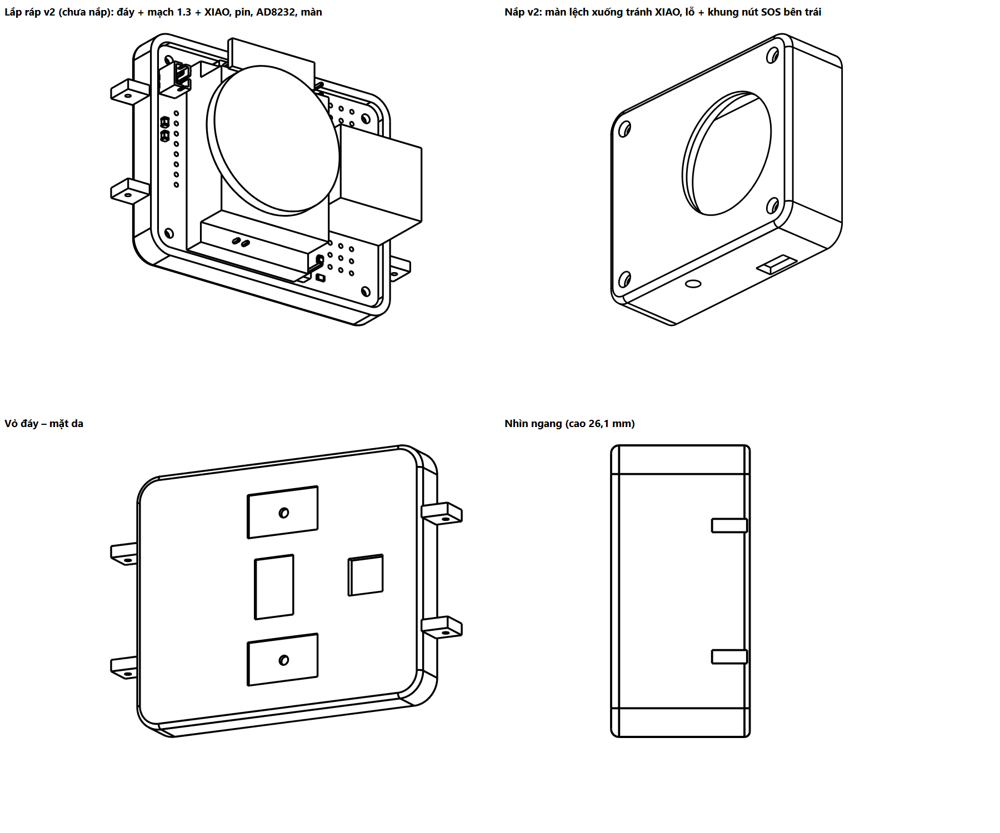

# Vỏ đồng hồ – bản v2 (in thử)

Vỏ 2 phần cho mạch module 1.3 (50,1 × 62,1 mm), vẽ bằng CadQuery (Python) từ file STEP của mạch.
Mở được trong Onshape: Import file `.step` (vẽ tiếp, sửa kích thước); in 3D bằng file `.stl`.

**Dùng bản `v2/`** (theo số đo thật ngày 01/11/2026). `v1/` là bản đầu, dùng số ước lượng, để tham khảo.



| File | Nội dung |
|---|---|
| `v2/vo_day.step`, `v2/vo_day.stl` | Vỏ đáy (mặt da): chứa mạch, cửa sổ cảm biến, hốc điện cực, tai đeo dây |
| `v2/vo_nap.step`, `v2/vo_nap.stl` | Nắp: ô nhìn màn tròn, vành giữ màn có chỗ cho tai chân màn, lỗ cạnh |
| `v2/lap_rap_vo_mach.step` | Lắp ráp: vỏ + mạch 1.3 + khối giả lập XIAO, pin, AD8232, màn |
| `cong_cu/vo_dong_ho.py` | Script tạo vỏ; sửa thông số ở đầu file rồi chạy lại |

Đã kiểm tra bằng máy: vỏ đáy và nắp không chạm mạch 1.3, không chạm khối XIAO, pin, AD8232, màn.

## Số đo thật dùng cho v2 (MINH đo 01/11/2026)

| Bộ phận | Số đo |
|---|---|
| XIAO | dài 23 mm (mic → USB-C); cao 8 mm từ đỉnh USB-C tới header cái; header cái 8,5 mm → **16,5 mm trên mặt mạch** |
| AD8232 | 8 mm (đỉnh jack 3,5 mm → đáy mạch module), đặt chồng trên pin |
| MAX30102 | 3 mm (linh kiện cao nhất → đáy mạch module), ở mặt dưới mạch |
| Màn GC9A01 (7 chân) | tròn Ø 35 mm, dày 3 mm, thêm tai chân 7 × 23 mm ở 1 bên |
| Pin | 45 × 30 × 5,5 mm + mút 1 mm |

## Kích thước và xếp chồng

- Ngoài: **54,9 × 66,9 mm**, cao **26,1 mm** (chưa tính tai dây). Thành 2 mm, khe hở quanh mạch 0,4 mm.
- XIAO cao 16,5 mm nên **màn được đặt lệch xuống phía dưới XIAO, nằm trên vùng pin** (tâm màn cách mép dưới
  mạch 20,6 mm, giữa theo chiều ngang). Nếu đặt màn ở giữa (đè lên XIAO) vỏ sẽ cao ~28 mm.

| Lớp (tính từ mặt da) | Cao (mm) |
|---|---|
| Đáy vỏ | 0 – 1,5 |
| Linh kiện mặt dưới mạch (MAX30102 3 mm, CJMCU-30205, D1/Q1) | 1,5 – 5,0 (4 cột đỡ 3,5 mm) |
| Mạch 1.3 | 5,0 – 6,6 |
| Mặt ghép đáy / nắp | 7,6 |
| Pin + mút | 7,6 – 13,1 |
| AD8232 (còn jack) | 13,1 – 21,1 |
| XIAO trên header cái | 6,6 – 23,1 |
| Module màn | 21,6 – 24,6 |
| Mặt nắp | 24,6 – 26,1 (ô nhìn Ø 33 mm) |

## Các chi tiết

- **4 vít M2** dài ~22–25 mm xuyên nắp → lỗ mạch H1–H4 → cột vỏ đáy (lỗ mồi 1,7 mm, vít tự ren). Đầu vít chìm
  trong lỗ khoét Ø 4,2 × 2 mm ở mặt nắp.
- **Cửa sổ MAX30102**: lỗ 13 × 9 mm, bậc 15 × 11 mm sâu 1 mm phía trong để dán **mica trong 1 mm**.
- **Cửa sổ MAX30205**: lỗ 8 × 8 mm cho cảm biến nhiệt áp sát da.
- **Điện cực LA, RL**: pad E1/E2 ở mặt dưới mạch cách da ~5 mm, không chạm da trực tiếp. Mặt ngoài đáy có 2 hốc
  9,4 × 16,4 × 0,6 mm để dán **tấm thép không gỉ / băng đồng**, mỗi hốc có lỗ Ø 2 mm luồn dây nối lên pad E1/E2.
- **Điện cực RA**: lỗ Ø 2,2 mm cạnh phải (ngang J6) cho vít thép M2; dây trong vỏ nối vào pad J6.
- **Nút SOS**: nút nhấn góc vuông 6 × 6 chân cắm (cao 10 mm từ đỉnh núm tới đáy kim loại, rộng 7, dài 11 tính cả chân).
  Núm tròn xuyên lỗ Ø 3,8 mm ở cạnh trái (ngang J5, cao 19,5 mm tính từ mặt da); thân nút nằm trong khung vuông
  6,4 × 6,4 sâu 4 mm ở mặt trong nắp (dán keo), có khe cho chân ra; nối 2 dây vào pad J5. Nằm trên pin, dưới màn,
  không chạm mạch hay module nào (đã kiểm tra).
- **Chân sạc pogo nam châm**: khe 10 × 5 mm cạnh trái (ngang J2). **Kích thước tạm**, đo đầu pogo thật rồi sửa.
- **Màn**: vành giữ Ø 35 mm có chỗ trống cho tai chân 7 chân quay về bên trái; dán màn vào mặt trong nắp.
- **Tai dây 22 mm** ở 2 đầu, lỗ chốt lò xo Ø 1,3 mm.
- Cổng USB-C của XIAO quay vào trong: nạp code thì tháo nắp; sạc hằng ngày bằng chân pogo.
- Motor rung 1027: dán băng keo 2 mặt vào thành trong vỏ đáy.

## In 3D

- Nhựa PLA cho bản thử; PETG cho bản đeo (bền, chịu mồ hôi).
- Lớp 0,2 mm, thành 3 đường, độ đặc 20 %.
- Vỏ đáy: đặt mặt da xuống bàn. Nắp: đặt mặt trên (ô màn) xuống bàn. Bật support cho tai dây và các lỗ cạnh.

## Làm mỏng hơn (tùy chọn)

- Tháo miếng nhựa đen của header đực dưới XIAO (−2,5 mm) hoặc dùng header cái thấp ~5 mm (−3,5 mm).
- Hàn thẳng XIAO xuống mạch, bỏ header cái (−8,5 mm, nhưng khó tháo XIAO).
- Tháo jack 3,5 mm của AD8232, hàn dây điện cực thẳng vào pad (−4 đến −5 mm).
Sửa `CAO_XIAO`, `CAO_PIN_AD8232` ở đầu script rồi chạy lại.

Chạy lại script (cần Python có CadQuery: `pip install cadquery`), trong thư mục `hardware/enclosure`:

```
python cong_cu/vo_dong_ho.py v2 ../pcb_module/dong_ho_module.step
```
