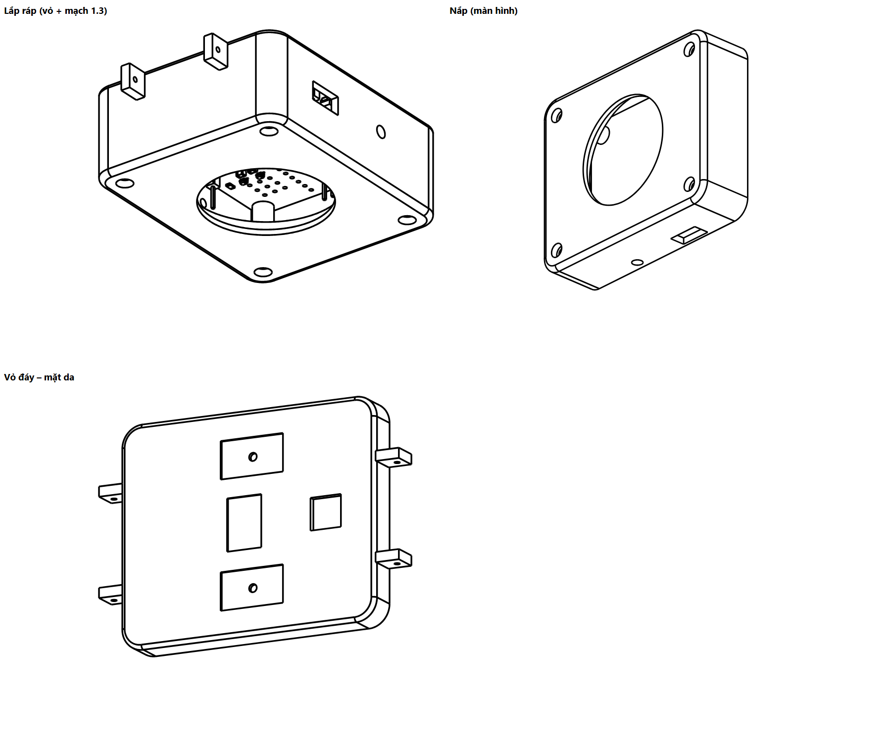

# Vỏ đồng hồ – bản v1 (in thử)

Vỏ 2 phần cho mạch module 1.3 (50,1 × 62,1 mm), vẽ bằng CadQuery (Python) từ file STEP của mạch.
Mở được trong Onshape: Import file `.step` (vẽ tiếp, sửa kích thước); in 3D bằng file `.stl`.



| File | Nội dung |
|---|---|
| `v1/vo_day.step`, `v1/vo_day.stl` | Vỏ đáy (mặt da): chứa mạch, cửa sổ cảm biến, hốc điện cực, tai đeo dây |
| `v1/vo_nap.step`, `v1/vo_nap.stl` | Nắp: ô nhìn màn hình tròn, vành giữ màn, lỗ cạnh |
| `v1/lap_rap_vo_mach.step` | Lắp ráp vỏ + mạch 1.3 để kiểm tra (đã kiểm: vỏ không chạm mạch) |
| `cong_cu/vo_dong_ho.py` | Script tạo vỏ; sửa thông số ở đầu file rồi chạy lại |

## Kích thước chính

- Ngoài: **54,9 × 66,9 mm**, cao **24,6 mm** (chưa tính tai dây). Thành 2 mm, khe hở quanh mạch 0,4 mm.
- Xếp chồng theo chiều cao (từ mặt da lên):

| Lớp | Cao (mm) | Ghi chú |
|---|---|---|
| Đáy vỏ | 0 – 1,5 | cửa sổ MAX30102, MAX30205, hốc điện cực |
| Linh kiện mặt dưới mạch | 1,5 – 5,0 | MAX30102, CJMCU-30205 (~3 mm), D1/Q1 (≤ 2,3 mm); 4 cột đỡ cao 3,5 mm |
| Mạch 1.3 | 5,0 – 6,6 | |
| Mặt ghép đáy / nắp | 7,6 | |
| XIAO trên header cái | 6,6 – 18,8 | phần cao nhất; pin + AD8232 ~ 16,7 |
| Module màn GC9A01 | 19,5 – 23,1 | giả định Ø 38,6 × 3,6 mm, **đo lại màn thật** |
| Mặt nắp | 23,1 – 24,6 | ô nhìn Ø 33 mm |

## Các chi tiết

- **4 vít M2** dài ~20–22 mm xuyên qua nắp → lỗ mạch H1–H4 → cột vỏ đáy (lỗ mồi 1,7 mm, vít tự ren). Đầu vít chìm trong lỗ khoét Ø 4,2 × 2 mm ở mặt nắp.
- **Cửa sổ MAX30102**: lỗ 13 × 9 mm, bậc 15 × 11 mm sâu 1 mm phía trong để dán tấm **mica trong 1 mm**.
- **Cửa sổ MAX30205**: lỗ 8 × 8 mm cho cảm biến nhiệt áp sát da.
- **Điện cực LA, RL**: pad E1/E2 nằm ở mặt dưới mạch, cách da ~5 mm nên không chạm da trực tiếp. Mặt ngoài đáy có
  2 hốc 9,4 × 16,4 × 0,6 mm để dán **tấm thép không gỉ / băng đồng**, mỗi hốc có lỗ Ø 2 mm luồn dây nối lên pad E1/E2.
- **Điện cực RA**: lỗ Ø 2,2 mm cạnh phải (ngang J6) cho vít thép M2; dây trong vỏ nối vào pad J6.
- **Nút SOS**: lỗ Ø 3,2 mm cạnh trái (ngang J5).
- **Chân sạc pogo nam châm**: khe 10 × 5 mm cạnh trái (ngang J2). **Kích thước tạm**, đo đầu pogo thật rồi sửa.
- **Tai dây 22 mm** ở 2 đầu, lỗ chốt lò xo Ø 1,3 mm.
- Cổng USB-C của XIAO quay vào trong: nạp code thì tháo nắp; sạc hằng ngày bằng chân pogo.
- Motor rung 1027: dán băng keo 2 mặt vào thành trong vỏ đáy hoặc mặt sau pin.

## In 3D

- Nhựa PLA cho bản thử; PETG cho bản đeo (bền, chịu mồ hôi).
- Lớp 0,2 mm, thành 3 đường, độ đặc 20 %.
- Vỏ đáy: đặt mặt da xuống bàn. Nắp: đặt mặt trên (ô màn) xuống bàn. Bật support cho tai dây và các lỗ cạnh.

## Cần đo lại trước khi in bản 2

1. Module màn GC9A01 thật: đường kính, độ dày, vị trí chân header → sửa `MAN_D`, `MAN_DAY` trong script.
2. Chiều cao XIAO trên header cái (đo thật) → `CAO_XIAO`.
3. Đầu pogo nam châm → khe sạc.
4. Nếu muốn mỏng hơn: hàn thẳng XIAO xuống mạch (bỏ header cái) giảm ~7 mm; sửa `CAO_XIAO` rồi chạy lại.

Chạy lại script (cần Python có CadQuery: `pip install cadquery`):

```
python cong_cu/vo_dong_ho.py v1 ../pcb_module/dong_ho_module.step
```
